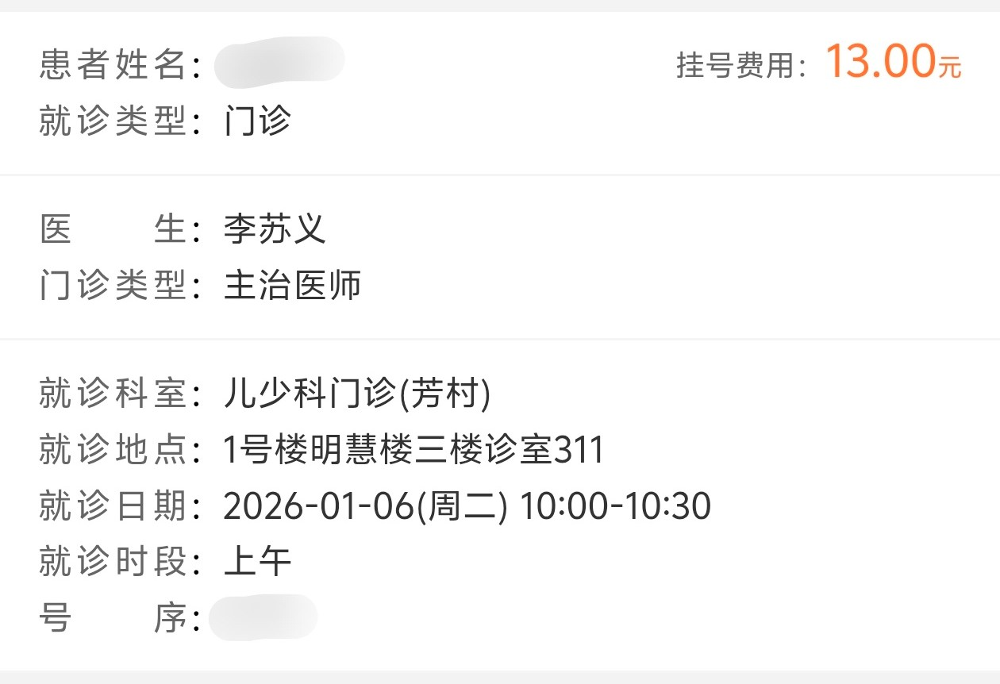

> [!CAUTION] 请注意！
> 本文仅为作者的个人记录，不构成医疗建议。记录的内容仅为个案，不应认为其可稳定复现。每个人的体验都可能不同。

在 [「音乐与记忆」：最爱的一场 Live](/posts/shinkiro) 这篇文章里我提到过，我 2023 年的时候被医生判断为抑郁症。可是，随着时间的推移，药物的作用似乎越来越弱，“抑郁症” 也越来越难用来解释我的症状。我确实从抑郁中脱身，可仍然被焦虑深深抓住。与此同时，我的情绪似乎也变得 “阴晴不定”，医生给了我治疗双相情感障碍的药物却没有效果。

我去了其他医院，找了不同的医生，试图找到真正的原因，却无功而返。我怀疑过是否自己得了 ADHD，然而并不是。

前段时间看到 Wen 发的 [亞斯濃度](https://www.wen-lab.tw/asperger/) 这篇文章，又想起很久之前曾有一个医生认为我有可能是阿斯伯格综合征（台湾称亞斯伯格症），于是点进了文章里的测评链接。得分居然高达 38 分。

又经过一些机缘巧合，我发现了 [青衫 Neuro](https://qingshanasd.cn/) 这个社区，了解到更多有关 ASD[^1] 的信息，也知道了一些对这方面比较有经验的医生。更加巧合的是，今年年初我就见过其中一个医生。虽说当时找他只是续药，正好他的号比较便宜，但出乎我意料的是，他居然主动提出想给我调药。我当时觉得很奇怪，然后就拒绝了。

*年初的挂号记录。*

了解到他在这方面的经验，加上年初那次经历，我决定去找这位医生。可是，这时候已经挂不到号了。接下来的几天，我一闲下来就去刷新挂号页面，都没看到有号。不想再等一周的我决定放手一搏：直接去求加号。

周二早上我一早出门，赶到医院，在看诊的间隙跟着其他人一起混进去，却又因害怕被拒绝不吭声就离开诊室。重复了好几次之后，我终于鼓起勇气，在其他人都退出去，准备继续看诊的时候，小声地说：“医生，我也想加个号。” 在说明了自己之前在同一个医院的别的医生那里看过、也找过他看过 ~~（虽说只是拿药）~~ 之后，成功地加到了号。这时，我已经是 +25 号了。

[^1]: 最新的 DSM-5 和 ICD-11 都不再将阿斯伯格综合征单列，而是将其归于 ASD（孤独症谱系障碍）。
