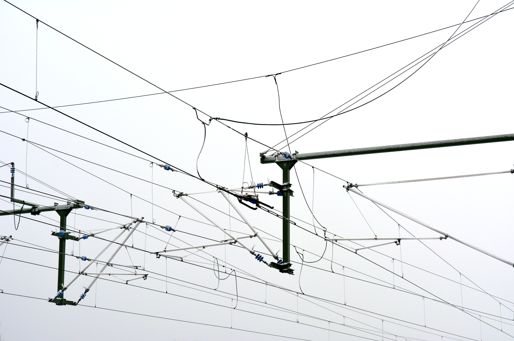
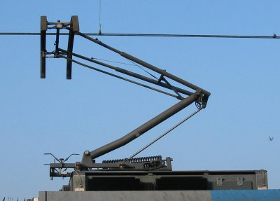

> [!TIP] BlogBlog 同乐会！
> 这是我的「[BlogBlog 同乐会 - 2026 年 7 月](https://blogblog.club/party/)」的投稿文章。本月主题是「[有趣的小知识或冷门概念](https://shuaixin.cc/Fun-Fact/)」，由[劉昕](https://shuaixin.cc/)主持。如果你有自己的博客，欢迎一起来参加！

各位有搭乘过高铁吗？是否有注意过轨道上方的电线呢？或许你会发现，似乎那条“电线”并不是笔直的一条，而是有一点弯弯曲曲的。这是错觉吗？就让我来告诉你吧！

_接触网。By XoMEoX - Electricity, CC BY 2.0, https://commons.wikimedia.org/w/index.php?curid=63706975_

## 我不叫“电线”，你也没出错觉

首先需要讲的是，这条“电线”有自己的名字，叫做“接触网”/“高架電車線”/“Overhead line”。而前文提到的“弯弯曲曲”也并不是错觉，而是真实存在的。

说到这里，紧随而来的估计就会是一个疑问：那好端端的，为什么要把这条线做成弯弯曲曲的呢？直接拉一条直的不是更方便吗？要搞明白这个问题，我们首先要知道高铁列车是怎么接收电能的。

在高铁列车上，有若干个接收电能的装置，这些装置叫做“受电弓”/“集電弓”/“Pantograph”。在这些装置的顶端，有一块用石墨和一些别的材料做成的板。当这些装置运作的时候，他会伸展开，像张开的弓一样，使得顶端的石墨板接触到“电线”，从而让电流入列车，驱动列车前进。

_一款常见的“之”字形受电弓。CC BY-SA 3.0，https://commons.wikimedia.org/w/index.php?curid=71114_

我们都知道，石墨是一种比较软的材料，很容易磨损。为了让石墨板磨损的更均匀，高铁上方的“电线”便被设计成“之”字形，从而保证石墨板可以被均匀的磨损，以此来延长寿命。这就是为什么我们看起来“电线”并不是笔直的一条了。

我们前面都在说高铁，但其实相当一部分轨道交通都有类似的情况，下次乘坐它们的时候，可以留意一下上方的“电线”，看看有没有这样的情况喔！
