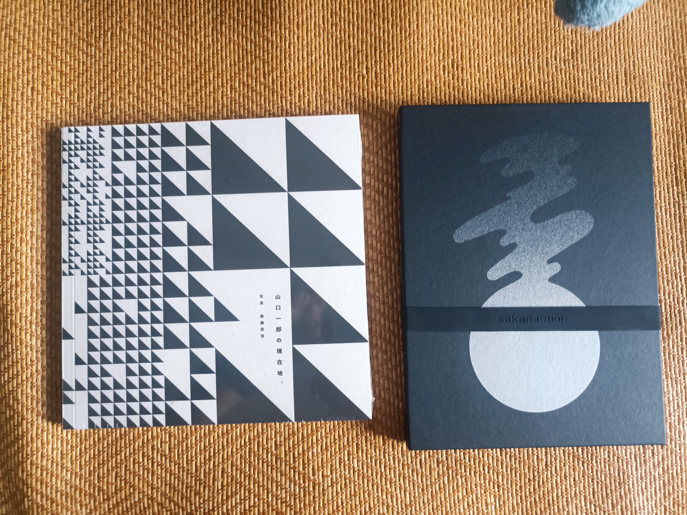

> [!TIP] BlogBlog 同乐会！
> 这是我的「[BlogBlog 同乐会 - 2026 年 6 月](https://blogblog.club/party/)」的投稿文章。本月主题是「[音乐与记忆](https://www.yozblog.com/posts/music-and-memories)」，由[柚子](https://www.yozblog.com/)主持。如果你有自己的博客，欢迎一起来参加！

我最喜欢的乐队是 サカナクション。他们开过很多场 Live，我也看过一些，但让我记忆最深，久久难以忘怀的，必定是他们乐队历程中最特殊的那一场：懐かしい月は新しい月 "蜃気楼"。

## 过去

时间回到 2022 年：乐队主唱山口一郎的身心情况急剧恶化，乐队活动被按下了暂停键。与此同时，当时只有十三四岁的我也正渐渐下沉——日渐加重的学业压力，一团乱麻的人际关系，还有重病不起的亲人，无不压得我喘不过气。在空闲的时间里，我便会打开他们上传到流媒体的录音室版音乐，试图从中找寻一些慰藉。

时间来到 2023 年中，我愈发变得孤僻，对一切都感到无比恐惧。医生告诉我，我得了抑郁症。我开始吃药。

而在海的对面，山口主唱经过了将近 1 年的休养，开始逐渐恢复活动。10 月开始的个人巡演「懐かしい月は新しい月 "蜃気楼"」便是这其中的一部分。根据计划，巡演的最后一场会在东京花园剧场举行，并且会进行在线直播。留意到这场特别的 Live 之后，我便购买了在线直播的限时观看权。

## 演出

2024 年 1 月 14 日，最后一场演出如期上演。我没去学校，坐在电脑前，听着那陈旧喇叭传出的音乐。那和他们往常的 Live 都有所不同，与其说那是歌声，倒不如说是山口主唱撕心裂肺的倾诉。

《目が明く藍色 (agraph remix)》是这场 Live 里我印象最深的一首。无论是音效还是视觉呈现都让我叹为观止。我至今难忘尾声时烟幕中山口逐渐模糊，最终倒下的投影。上半场也就此结束。

短暂的场间休息过后，下半场开始。在中间穿插的聊天环节，我第一次知道，原来我一直崇拜的偶像，也曾和我一样，遭受着抑郁的折磨。我盯着屏幕愣住了，脑海里浮现起那些个戴着耳机，听着歌曲独自入眠的夜晚，不由得想：“原来这个现在站在成千上万人面前的他也曾抑郁过啊。” 那一刻，仿佛一个声音在说，我也可以，从这里，走出来。

## Encore

Encore 环节是最出乎我意料的。乐队的 5 名成员全部回到了舞台上，共同演奏了《新宝島》。随后山口主唱进行了重大发表：乐队完全复活！那一刻，我感到无比兴奋，甚至可以说是我长这么大最兴奋的一刻。我感觉到沉睡在记忆中的什么东西回来了：不只是喜欢的乐队，还有那些从歌曲中得来的快乐。

## 之后

那之后，我又得投身于繁重的学习中去，但有些东西变得不一样了——以前我总觉得自己或许就要这样浑浑噩噩一辈子，永世不得翻身。但那天之后，我开始想， 连山口主唱那样站在几万人面前的人，都曾经完全站不起来，那我现在站不起来，也不意味着我就会一直这样。

现在，虽然我还是时不时会被情绪困住，但我不再把自己关起来，而是试着去和他们共存。我想，属于我的舞台，应该就在前面等着我吧。

## Off Topic

_~~你怎么知道我有这场演出的 Blu-ray~~_