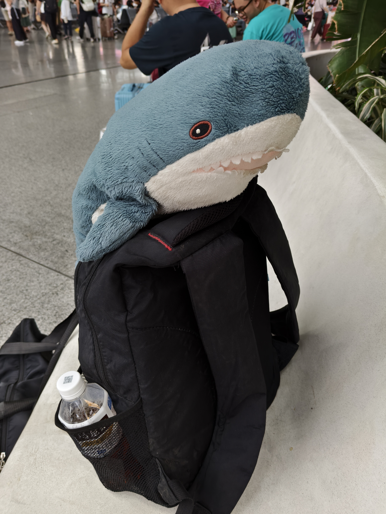
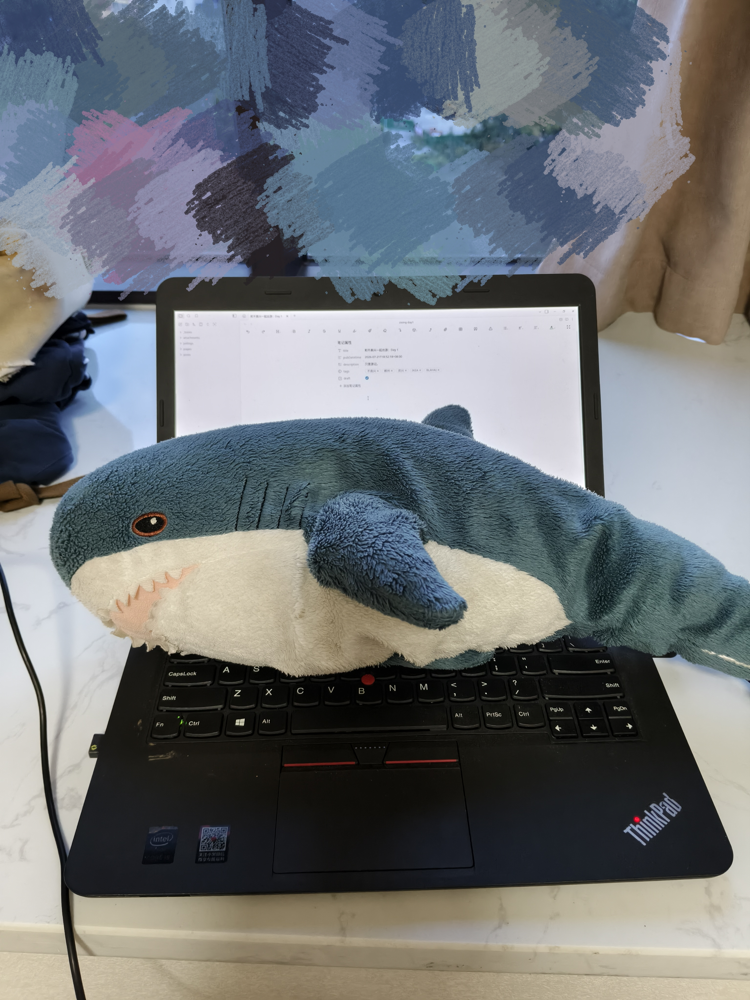

> [!TIP] 系列作品！
> 这是“和不高兴一起出游（郴州资兴）”系列作品的一部分。[目录](/posts/zixing-trip)  | [下一篇](/posts/zixing-day2)

今天带着不高兴[^1]一起出门旅游，去湖南郴州。我们有亲戚住在那里。

中午 12 点，出发！

_不高兴趴在我的背包上。摄于广州南站候车室。_

经过 1 个多小时的车程，我们到达了郴州西高铁站。接着坐接驳车到资兴。开接驳车的师傅很热情，打转向灯的习惯很好，每次变道或是转弯都会提前好一会打灯。

当然跟其他类似定位的城市一样，郴州也充斥着一种奇怪的气氛——没人住的高耸入云的空房子、各种经济上行时期开工但尚未完工的遗址等等。这种气氛在我们到达住的地方时显得格外明显。

到啦！虽说建筑的外立面和屋子里的装修显得房子很新，但走廊里昏暗的灯光、破碎的漆面却给人一种不是废墟，胜似废墟的感觉。

把电脑拿出来，写点东西吧。

_不高兴趴在我的电脑上，~~试图阻止我写文章~~。_

吃过晚饭我们去江边走了走。

_江边的风景。_

今天大概就是这样了。明天我们会去到别的地方玩。

[^1]: 我家那条小的 IKEA 鲨鱼的名字。我还有一条大鲨鱼叫作没头脑。
