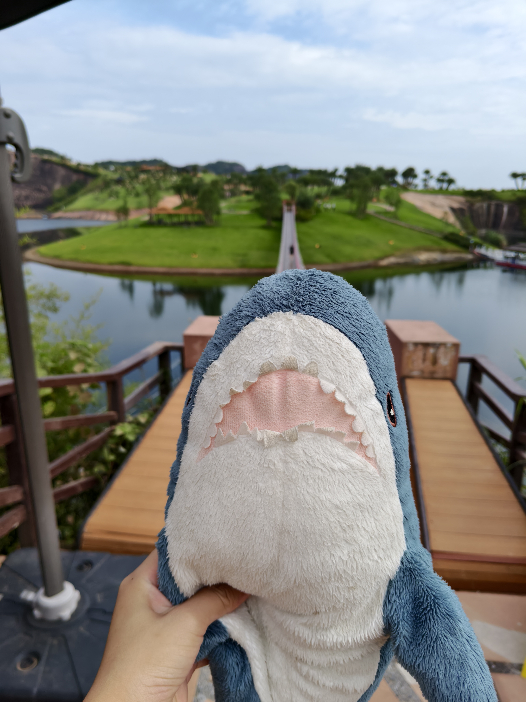
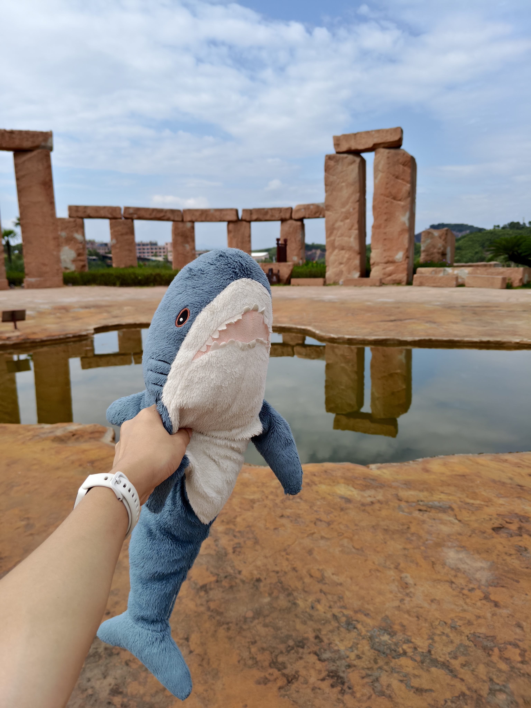
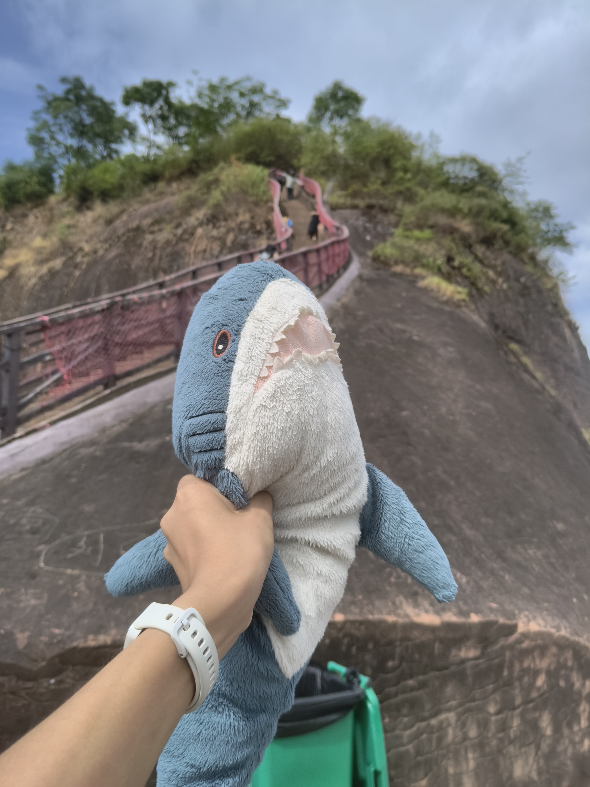

> [!TIP] 系列作品！
> 这是“和不高兴一起出游（郴州资兴）”系列作品的一部分。[目录](/posts/zixing-trip) | [上一篇](/posts/zixing-day1) | [下一篇](/posts/zixing-day3)

今天起得很早。虽然说昨天晚上没怎么睡好但是意外得很精神。吃早餐前去附近走了走。我们住在江边，早上很凉快。

吃完早餐就出发去高椅岭。高椅岭是比较新的景区，21 年才开放。

_吊桥。_

我们花了大概 30 分钟就爬到了山顶。一路上视野非常开阔，缺点就是比较晒。不过今天太阳不算大，也有风，弥补了这一点。

_巨石阵。_

高椅岭是一个比较典型的丹霞地貌。据说登山的梯级是直接用原本的石头切割出来的。真是集大自然的鬼斧神工与人类现代科技发展成果为一体才能有这样的成果啊。

_半山腰。_

接下来一个半小时我们继续在山林里穿行。这部分就没什么好说的了。

下午和晚上休息。明天去东江湖。