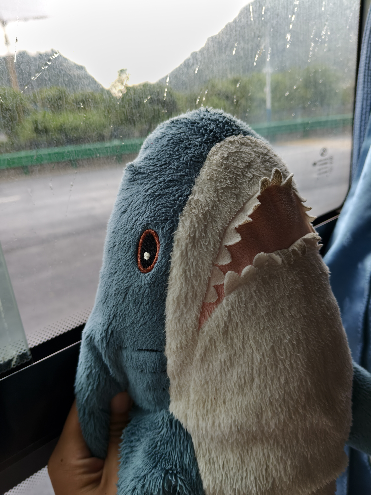
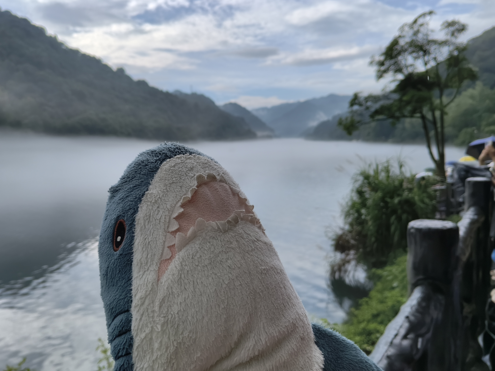
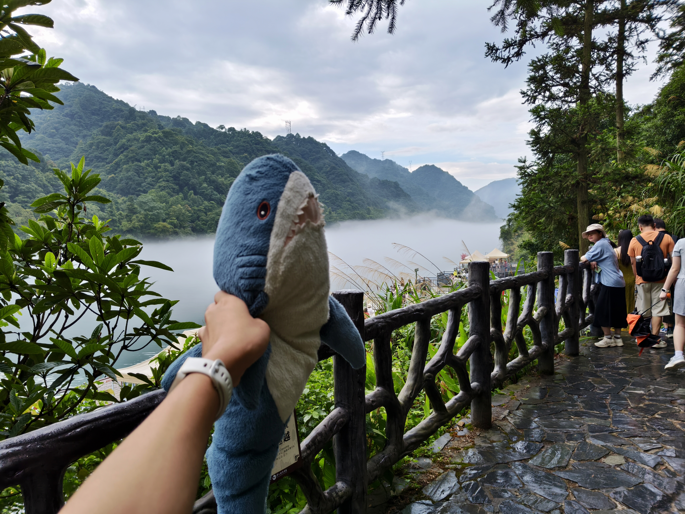
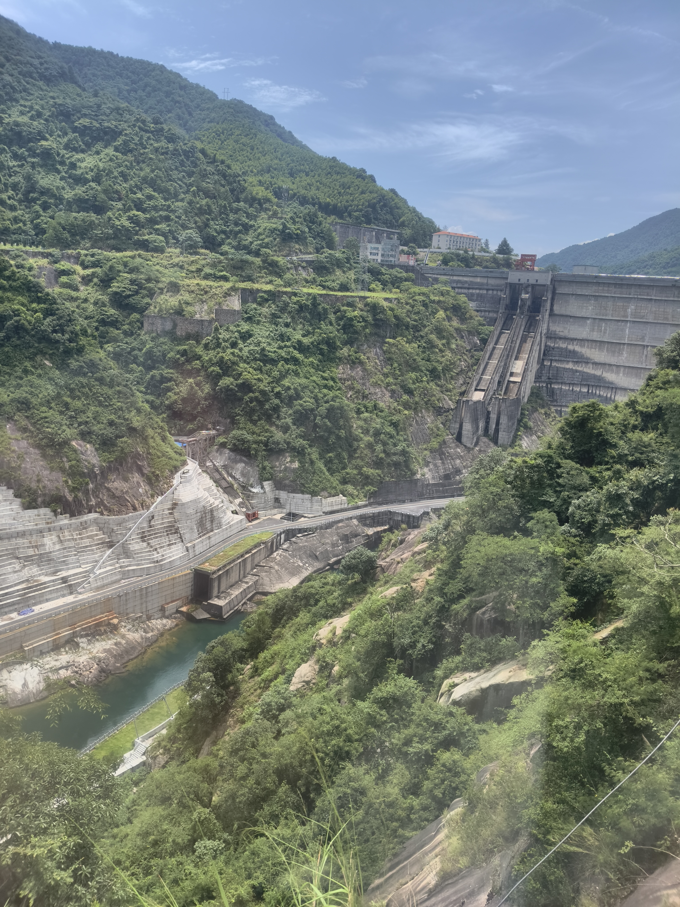
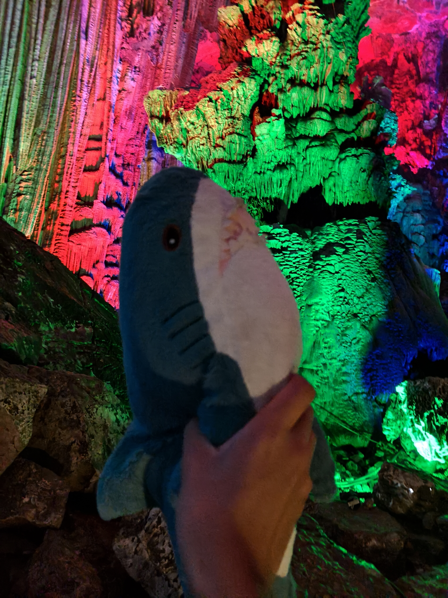

> [!TIP] 系列作品！
> 这是“和不高兴一起出游（郴州资兴）”系列作品的一部分。[目录](/posts/zixing-trip) | [上一篇](/posts/zixing-day2) | [下一篇](/posts/zixing-day4)

今天一早起来吃过早饭就前往东江湖景区。到景区后坐上接驳车，沿着小东江旁的山路蜿蜒前行。

_光线原因显得很脏的不高兴。~~虽然 TA 本来也没有多干净~~。摄于景区接驳车上。_

我们跟着人群在中途的车站下了车，走到河边的栈道上。这一段河叫作小东江，以早上江面上会弥漫浓厚的雾而闻名。我们去的比较早，因此有幸看到了浓厚的雾笼罩河面的胜景。

_弥漫着雾的小东江。_

我们大概在河边走了一公里。接着我们就再次上了接驳车，去东江大坝坐船，往湖中见的那个岛。

_大坝。_

_去往湖心岛的船上。摄于甲板。_

湖心岛上有一个大溶洞，别的基本上就没有了。溶洞里有五颜六色的灯光，衬得洞窟里如同仙境一般。洞里还很凉快，与外面形成鲜明对比。

_摄于溶洞内。_

后面我们就往回走了。行程已经过半，接下来要去哪里呢？尽请期待！
