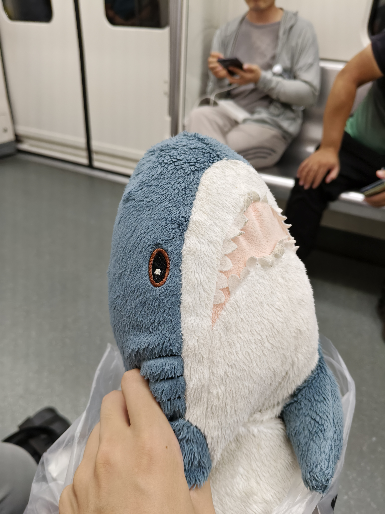

> [!TIP] 系列作品！
> 这是“和不高兴一起出游（郴州资兴）”系列作品的最后一篇。[目录](/posts/zixing-trip) | [上一篇](/posts/zixing-day3)

## Day 4

休息一天，就在附近走了走。明天回家。

## Day 5

台风要来了，从广州南站回家的城轨停运了，只好坐地铁转公交车回家了。

_不高兴搭地铁。_

## End

> 终于，到家了吗？
> 
> 好像是做了一场梦呢……

言归正题。郴州的山水很美，当地的人们也很友善热情。虽然说和许多小城市一样，面对着经济下行偏冷的影响，未来蒙上一层灰色，~~但那毕竟是以后的事了~~。

总而言之，郴州单纯来玩个几天是好地方，但别的的话实在是不敢恭维。如果有下次的话或许还会来吧。
