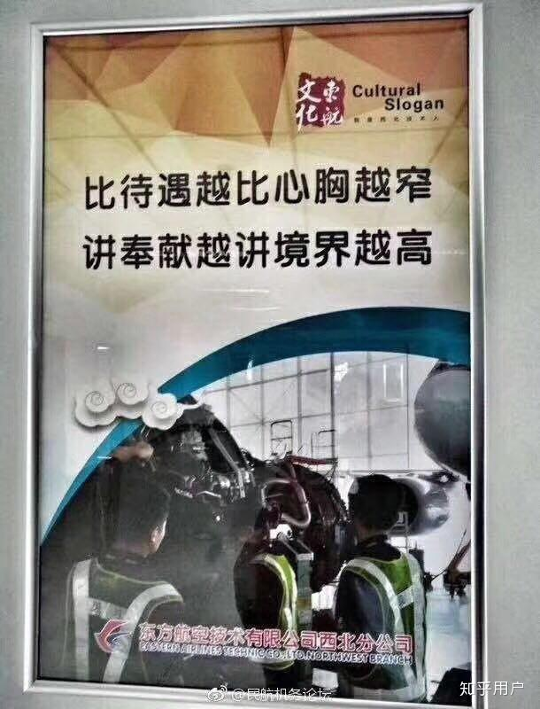

_事故当天执飞 MU5735 的飞机在事故前的照片。作者 Dennis HKG - [https://www.flickr.com/photos/79691705@N05/51966478673/](https://www.flickr.com/photos/79691705@N05/51966478673/)，CC BY 2.0，https://commons.wikimedia.org/w/index.php?curid=125486185_

时光飞逝，转眼距离那起惨剧已经 4 年过去。132 条生命永远长眠于山林深处。

然而令人遗憾的是，4 年多过去了，中国民航等单位[^1]仍然不愿面对那或许残酷的现实。

## NTSB 与 FOIA

如果说一直以来还可以用事故“非常复杂，极为罕见”作为迟迟不发出调查结论的借口，那今年 5 月初 NTSB（美国国家运输安全委员会）应 FOIA （《信息自由法》）公布的包括飞行数据记录器（FDR，俗称“黑匣子”之一）在内的一系列资料则是彻底扯下了这块遮羞布。

首先介绍一下为什么会有 NTSB 的出场。根据 ICAO（国际民航组织）的规定，空难调查由发生地国主导，航空器注册所在国、运营人所属国、设计国与制造国都有权派出“受权代表”参与调查。在这次事件中，美国作为涉事飞机的设计、制造国就派出了波音和 NTSB 的人员参与调查。

根据 NTSB 发布的资料[^2]，在飞机坠毁前 90 秒，飞行数据记录仪记录到飞行员关闭了飞机的两台发动机，并且猛烈向下推操纵杆使得飞机俯冲，下降角甚至达到了 40 度。当然出于职业道德（非主导方在主导方未授权时不得擅自发布调查结论），NTSB 并没有盖棺定论，但我们已经可以大致知道：飞机大概率是被人为操纵坠毁的。

## 老大哥正看着你

NTSB 的资料一放出，立刻引起轩然大波。当时的我正在 Bilibili 上闲逛，偶然发现了一个“美国西方航空5735”的视频。~~不得不佩服这些人对抗审查的脑洞~~。当然很快相关的信息就在中国大陆局域网里全面消失了。

自 2022 年事发之后，网上就鲜有受害者家属的发声或对他们的采访。这也很能说明问题。事实上，曾有个别受害者家属在网上发声，但据我观察，公开可见的家属发声内容很少，且部分帖子在发布后消失。似乎只要把他们的嘴捂上问题就不存在了，这些人失去的亲人只是这个国家付出的一点小代价无所谓。

## 非必要勿乘中国民航

先说清楚，我知道航空是最安全的交通工具之一，但是我猜你也不想如果真的不小心碰到了小概率的情况，家属连你怎么死的都不知道吧。

虽然另一交通巨头国铁集团也没好到哪去，但是论安全记录，还是比民航要好。就算一定要乘坐中国民航，也请务必避开中国东方航空，毕竟：

_图片来自网络。_

[^1]: 你知道我说的是谁。

[^2]: 你可以在[这里](https://securefoia.ntsb.gov/app/ReadingRoom.aspx)找到 NTSB 发布的资料。
