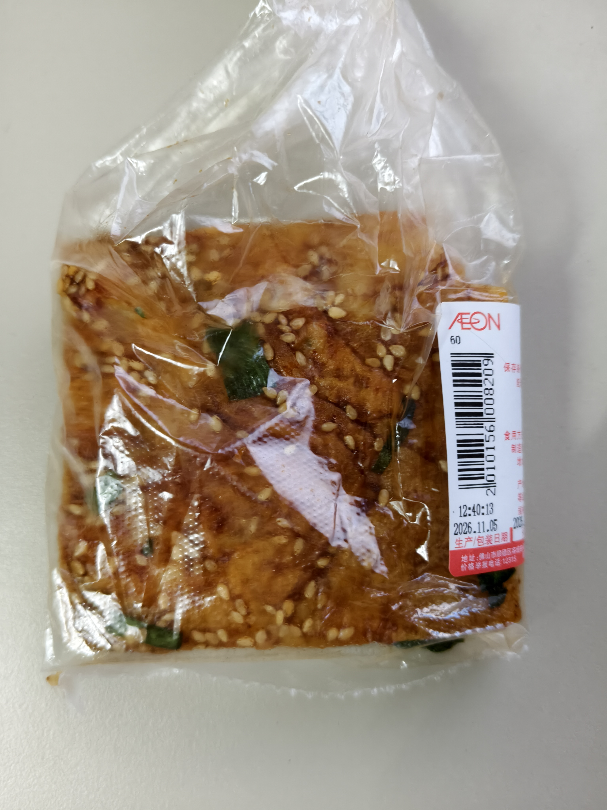

相信听过 _[我是一個蛋餅，離我遠一點。](https://wiwi.video/w/ozkiYHBM1mbyw5jphn42sC)_ 的人看到标题已经开始笑了吧。如果你没听过的话，不妨点击链接或者下面的视频卡片（均来自 wiwi.video），一边听一边继续看文章。

<iframe title="我是一個蛋餅，離我遠一點。" width="100%" height="100%" src="https://wiwi.video/videos/embed/ozkiYHBM1mbyw5jphn42sC" allow="fullscreen" sandbox="allow-same-origin allow-scripts allow-popups allow-forms" style="border: 0px; position: absolute; inset: 0px;"></iframe>

今天中午，兴致大发的 Meowjay 决定前往 AEON Supermarket[^1] 觅食。乘坐公车经过几个站后，紫红色的 AEON 标志便出现在眼前。

走入超市，Meowjay 抓起一盒炸猪排、几块 “蛋饼” 以及一罐汽水，付了款，开始吃。吃完之后，感到有点口渴的 Meowjay 决定再来一杯冰奶。经过漫长的等待之后，Meowjay 一边喝着冰奶，一边走路往家的方向走。

_涉事 “蛋饼” ~~其实是酱香饼~~_

_~~涉事冰奶忘记拍照片了~~_

回到家后，Meowjay 就拉肚子了。

_The End_

[^1]: 日本 AEON 集团旗下的超级市场，在多个国家或地区都设有分店。
