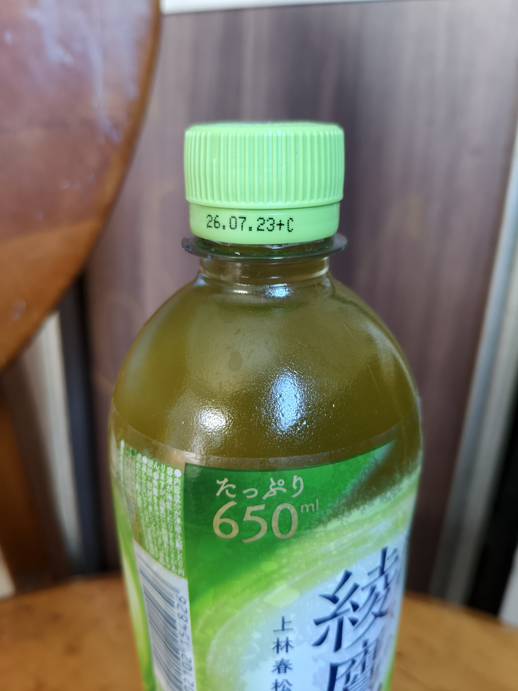
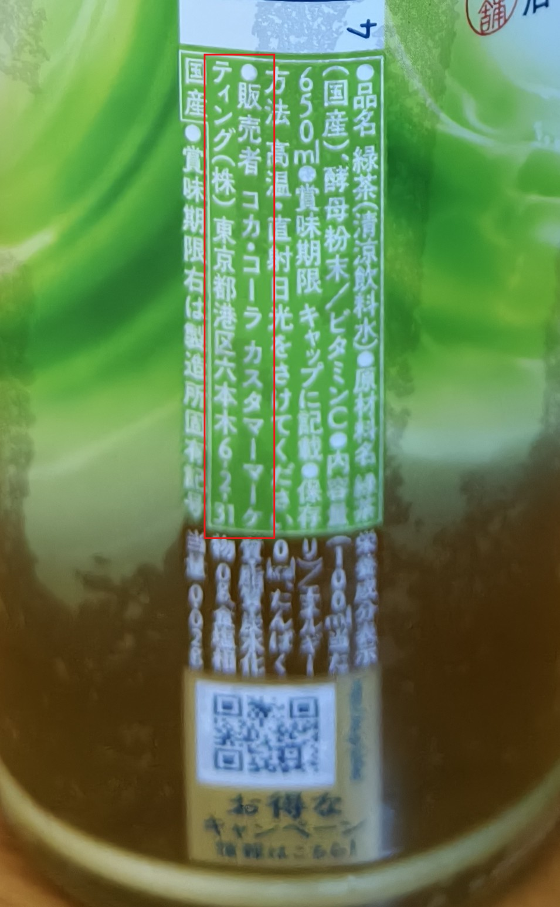
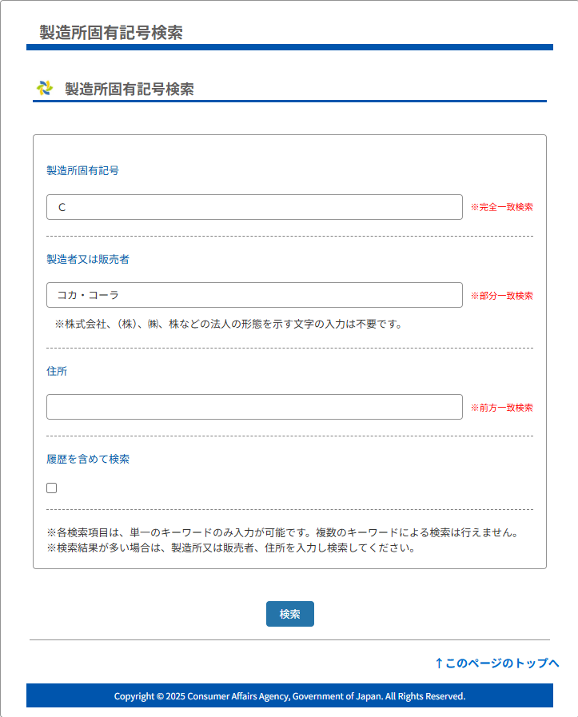
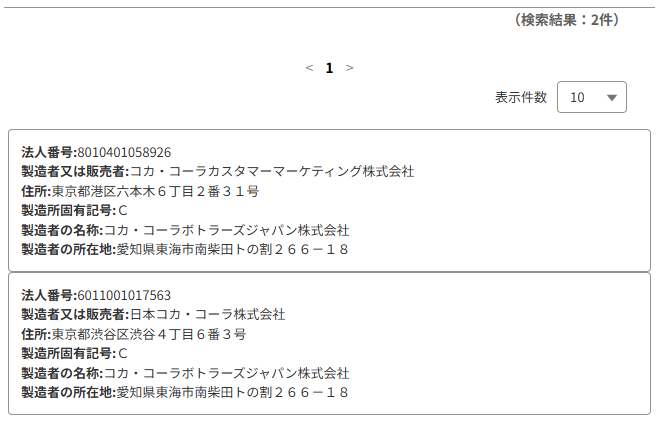

> [!TIP] BlogBlog 同乐会！
> 这是我的「[BlogBlog 同乐会 - 2026 年 7 月](https://blogblog.club/party/)」的投稿文章。本月主题是「[有趣的小知识或冷门概念](https://shuaixin.cc/Fun-Fact/)」，由[劉昕](https://shuaixin.cc/)主持。如果你有自己的博客，欢迎一起来参加！

如果你买过日本的食品，可能会留意到：相当一部分的日本食品并不会在包装上写明制造厂的地址以及联系方式。这是否意味着作为消费者的我们就无法知道这些信息了呢？并不是。这时候，“製造所固有記号”就出场了。

## 这是什么

这是日本消费者厅的解释[^1]：

> 食品表示法に基づく食品表示基準では、「製造所の所在地及び製造者の氏名又は名称」等の表示を義務付けていますが、原則として同一製品を2以上の製造所で製造している場合には、あらかじめ消費者庁長官に届け出た製造所固有記号の表示をもって「製造所の所在地及び製造者の氏名又は名称」等の表示に代えることができます。

> 根据《食品表示法》的食品表示标准，虽然规定有义务标注“制造地地址及制造者姓名或名称”等，但原则上同一产品在两个以上制造地生产时，可以通过标注提前向消费者厅长官备案的制造者识别代码，来代替“制造地地址及制造者姓名或名称”等标注。

## 怎么查

现在我们已经知道了“製造所固有記号”是什么，但这并不能解决我们刚刚提出的问题：“怎么找到生产工厂的信息？“ 因此我们还得进行下一步：查询。

在输入引擎里输入”製造所固有記号“，可以搜出很多结果，但我只推荐用日本消费者厅官方的查询工具 [製造所固有記号検索](https://www.fld.caa.go.jp/caaks/s/cksc01)。从前面引用的官方解释可以看到，所有”製造所固有記号”都需要在消费者厅先行备案，因此从消费者厅查询得到的结果理论上是最准确，最全面的。而且，消费者厅的查询工具对移动端的适配也更好，这一点的重要性我之后会提到。

### 准备

在开始之前，我们需要做一些准备工作。你需要：

- 一部能运行现代浏览器[^2]的设备
- 日文输入法
- （可选）触摸屏
- （可选）日文手写输入法

万事俱备，我们开始！

### 查询

我以我最近购买的一瓶“綾鷹”绿茶举例。首先找到製造所固有記号，通常会和“賞味期限”印在同一个地方，我这瓶绿茶的在瓶口，+号后面的就是了。

接下来找到“販売者”这一栏。

打开查询工具，页面大概长这个样子。现在我们需要把刚刚找到的“製造所固有記号”和“販売者”输进去。如果你不太会输日语，我建议在手机上操作，并且安装一个日语手写输入法（比如说 Gboard），这样输”販売者“那一栏的时候会简单很多。输完之后按下”検索“就会有结果了。

_查询工具页面的截图。随着时间推移，页面布局可能会有所改变，敬请留意。_

---

## FAQ

**Q1**：“+”号到底要不要输进去？

**A1**：不用。输进去反而会搜不出来。

---

**Q2**：为什么要把“販売者”输进去？

**A2**：不同企业可以使用同一个“製造所固有記号”。以我上面的“綾鷹”绿茶为例，如果只把“C”输进去，会得到几百个结果，这显然是我们不希望看到的。

---

**Q3**：“販売者”这一栏也太长了吧！输起来真麻烦。

**A3**：因为这一栏只要求部分一致，所以只需要把一部分输进去就可以了。同样以“綾鷹”绿茶为例，只要把”コカ・コーラ“输进去就可以了。

---

**Q4**：所以你写这些有什么用？

**A4**：我也不知道。

---

## 脚注

[^1]: [製造所固有記号制度届出データベース | 消費者庁](https://www.caa.go.jp/policies/policy/food_labeling/unique_code/)

[^2]: Chrome / Firefox / Safari 应该都可以，不过如果你还在用 Internet Explorer 的话…… 祝你好运。
